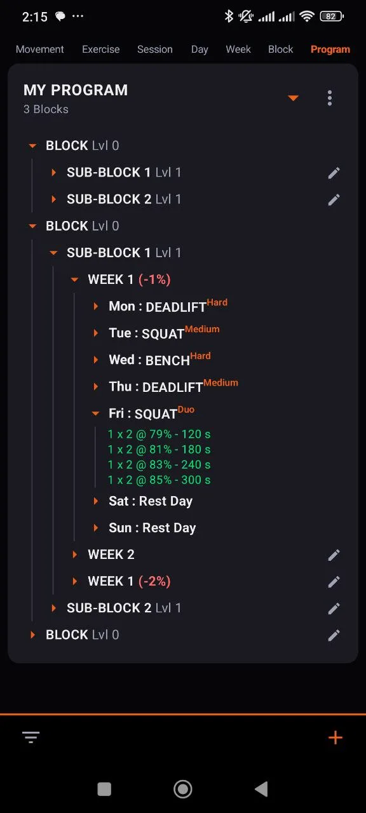
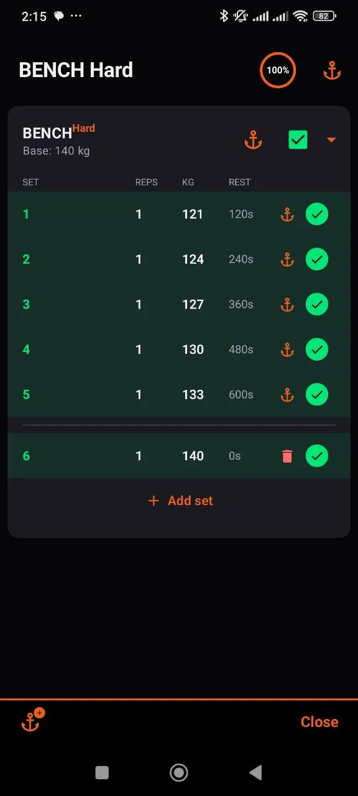
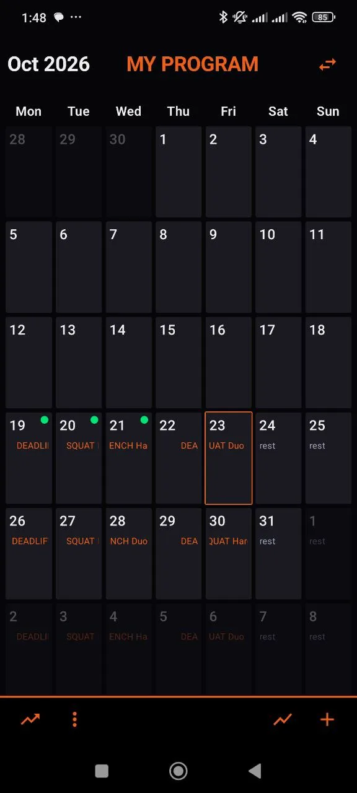
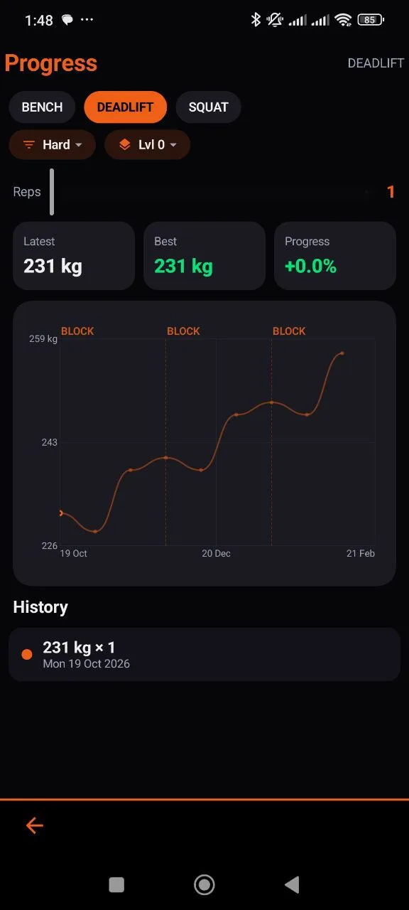

# Basic Planner

An offline Android app for planning strength training and tracking what you actually lift.

You build the plan as a tree — **Program → Block → Week → Day → Session → Exercise → Set** — attach
notes, RPEs or media to any node, run the sessions from the calendar, and then compare the planned
progression against your recorded performances in a dashboard.

<p align="center">
  
  
  
  
</p>

## Download

**Latest APK (always the newest build):**
<https://github.com/ymzindustry/basicplanner/releases/latest/download/BasicPlanner-latest.apk>

Every release publishes its APK under that exact asset name, so the link above never goes stale.
Releases are listed on the [releases page](https://github.com/ymzindustry/basicplanner/releases).

- Package: `com.ymz.basicplanner.v10`
- Android 8.0+ (minSdk 26), targets API 36
- Debug-signed builds: installing over a build signed with a different key requires uninstalling
  first — export your programs as `.bpent` before doing so.

## Features

**Planning**
- Free-form hierarchy: any number of blocks and sub-blocks, weeks inside blocks or directly in a
  program, days/sessions/exercises in a weekday slot.
- Block levels are derived from depth (a block directly in the program is level 0), so the tree is
  the only thing you edit.
- Percentage adjustments on every level, plus per-child adjustments, applied as a chain when a
  session is started or a chart is computed.
- Rep-max settings per movement with **Day / Week / Block-level / Custom / Constant** interpolation,
  so a plan can ramp 100 → 120 kg across days, weeks or blocks.

**Training**
- Calendar agenda with all sessions of the active program.
- Session runner with set-by-set progress and a foreground rest timer (keeps running, notifies when
  the rest is over).
- Added sets can carry a direct weight instead of a percentage of the base RM.

**Tracking**
- Progress dashboard: recorded performances and the planned goal curve on the same chart, with a
  real weight axis and a date axis spanning the whole program.
- Filter by movement *and* by variant (`Deadlift Medium` vs `Deadlift Wide`).
- Optional block bands behind the curve (level 0 by default, deeper levels on demand).
- Personal best, latest and progress percentage for the current filter.

**Items**
- Typed item families (string, int, float, boolean, image, video) attachable to any entity.
- Overview dialog with attached and free items, colour-coded by type, tap to edit, long-press to
  remove.

**Data**
- Everything is stored locally (DataStore + kotlinx.serialization); no account, no network.
- Export the full program as JSON or XLSX, and share programs as `.bpent` files.

## Build

Requirements: JDK 17, Android SDK with platform 36 and build-tools 36.0.0.

```bash
export JAVA_HOME=/path/to/jdk-17
export ANDROID_HOME=/path/to/android-sdk
./gradlew --no-daemon testDebugUnitTest assembleDebug
```

The APK lands in `app/build/outputs/apk/debug/app-debug.apk`.
`local.properties` is not committed — point `sdk.dir` at your SDK.

## Project structure

```
app/src/main/java/com/ymz/basicplanner/
├── model/        entities, plan math (adjustments, interpolation, goal series), item overview
├── ui/           screens: agenda, creation, session, dashboard, main activity
├── compose/      shared composables: tree views, dialogs, charts, marquee text
└── data/         persistence, exports, file conversion, rest timer service
```

`docs/diagrams` holds the data and functional structure as PlantUML.

## Tech

Kotlin, Jetpack Compose (Material 3), AGP 8.13, Gradle 8.13, kotlinx.serialization, DataStore,
Media3, Coil. Unit tests cover the plan mathematics (adjustments, interpolation, goal curves,
segments, items) and one Robolectric test renders the entity tree to catch layout regressions.

## License

Personal project — all rights reserved unless stated otherwise.
